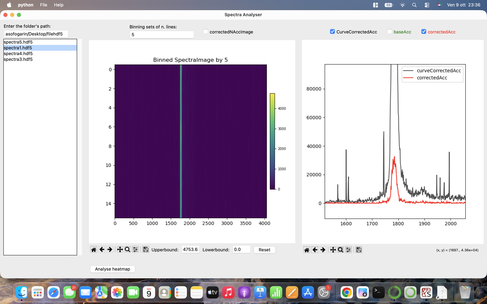
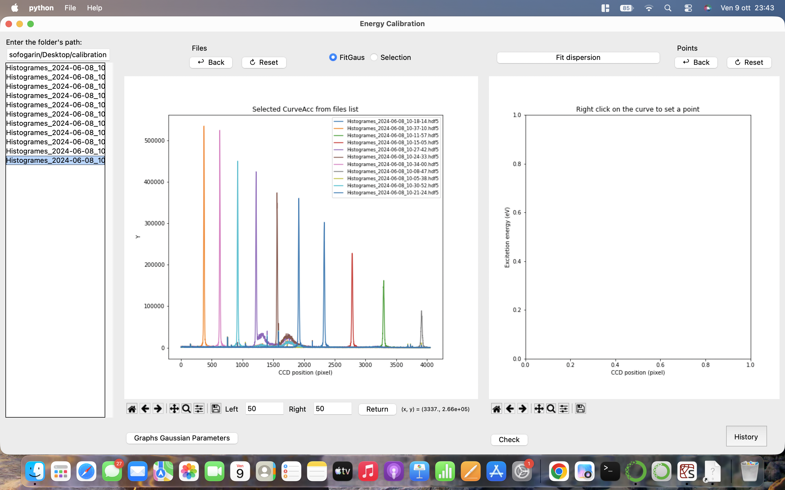

# RIXS Beamline GUI

Desktop tools for exploring and calibrating **Resonant Inelastic X-ray Scattering (RIXS)** data stored in HDF5 files, built with Python and Tkinter.

Developed during my internship at **Synchrotron SOLEIL** (Paris, Aug-Oct 2024) at the SEXTANT beamline, with the goal of making day-to-day data inspection faster for beamline scientists and visiting researchers.






## What it does

The project contains two tools, started from a small launcher window.

### 1. Spectra Analyser

- Browse a folder of `.hdf5` files, listed from newest to oldest.
- Display the detector image as a heatmap, with an option to switch to the curve-corrected image.
- **Row binning**: average sets of *N* lines to improve the signal-to-noise ratio.
- **Intensity cuts**: set upper and lower bounds on the color scale, with one-click reset.
- Plot the integrated curves (`curveCorrectedAcc`, `baseAcc`, `correctedAcc`) and compare them.
- **Heatmap Analyser** window:
  - *Stacks* tab: plot the image rows as stacked spectra, with adjustable sampling interval and vertical offset. Right-click a spectrum to apply an X shift or a multiplicative factor.
  - *Lines* tab: right-click rows directly on the heatmap to select them and compare their spectra.
- Save a screenshot of the window as PNG.

### 2. Energy Calibration

- Select one or several files and overlay their spectra against CCD position (pixels).
- Right-click on a peak and enter its known energy. Two modes:
  - **FitGaus**: a Gaussian is fitted in an adjustable window around the click (Left/Right pixel interval in the toolbar) and the fitted peak center is used as the calibration point.
  - **Selection**: the clicked position is used directly.
- **Fit dispersion**: a second-order polynomial relating pixel and energy,

  `E(x) = a·x² + b·x + c`

  The coefficients are shown on the plot and appended with a timestamp and the points used to `fit_results.txt`, which can be reopened from the **History** button.
- **Check**: apply the calibration and plot the spectra against excitation energy (eV).

## Installation

Requires Python 3.8+ and Tkinter (included with most Python installers; on Debian/Ubuntu install it with `sudo apt install python3-tk`).

```bash
git clone https://github.com/TomFogarin/rixs-beamline-gui.git
cd rixs-beamline-gui
python -m venv .venv
source .venv/bin/activate        # Windows: .venv\Scripts\activate
pip install -r requirements.txt
```

## Usage

```bash
python main.py
```

Choose a tool, type the path of the folder containing your `.hdf5` files in the "Enter the folder's path" box and press Enter, then click a file in the list.

### Expected data layout

The tools read the following HDF5 datasets:

| Tool | Datasets |
|---|---|
| Spectra Analyser | `spectraImage`, `curveCorrectedAcc`, `spectraCurveCorrectedNAccImage`, `spectraCorrectedNAccImage`, `correctedAcc`, `baseAcc` |
| Energy Calibration | `HistogramCorrected` (falls back to `correctedAcc`) |

Files must have the `.hdf5` extension.

### Try it without real data

No experimental data are included in this repository. To try the interface, generate a few synthetic files:

```bash
python examples/make_synthetic_data.py
```

This writes three files with artificial Gaussian peaks to `examples/data/`. Point the tools to that folder. For the Energy Calibration, right-click the peaks near pixels 300, 520 and 740 (first file) and enter any three increasing energies, for example 500, 505 and 510 eV.

## Project structure

```
rixs-beamline-gui/
├── main.py                       # launcher window
├── rixs_gui/
│   ├── spectra_analyser.py       # Spectra Analyser and Heatmap Analyser
│   └── energy_calibration.py     # Gaussian fits and dispersion calibration
├── examples/
│   └── make_synthetic_data.py    # synthetic HDF5 files for testing
├── requirements.txt
└── LICENSE
```

## Tech stack

Python · Tkinter · Matplotlib · NumPy · SciPy · h5py · Pillow

## Known limitations and roadmap

- The dataset names follow the SEXTANT file layout; making them configurable would let the tools work with other beamlines.
- The dispersion fit needs at least three calibration points.
- The screenshot function uses Pillow's `ImageGrab` (Windows, macOS, and X11 on Linux).
- Planned: plots of the fitted Gaussian parameters, in-app instructions, refactoring of the GUI state into classes, English translation of the code comments, and unit tests for the fitting and binning routines.

## Acknowledgements

Commissioned by Alessandro Nicolau, with supervision from him and Victor Porée at Synchrotron SOLEIL.

## Author

**Tommaso Fogarin**: M.Sc. student in Engineering Physics, Politecnico di Milano
[LinkedIn](https://linkedin.com/in/tommasofogarin25) · fogarintommaso@gmail.com

## License

Released under the MIT License (see `LICENSE`).
